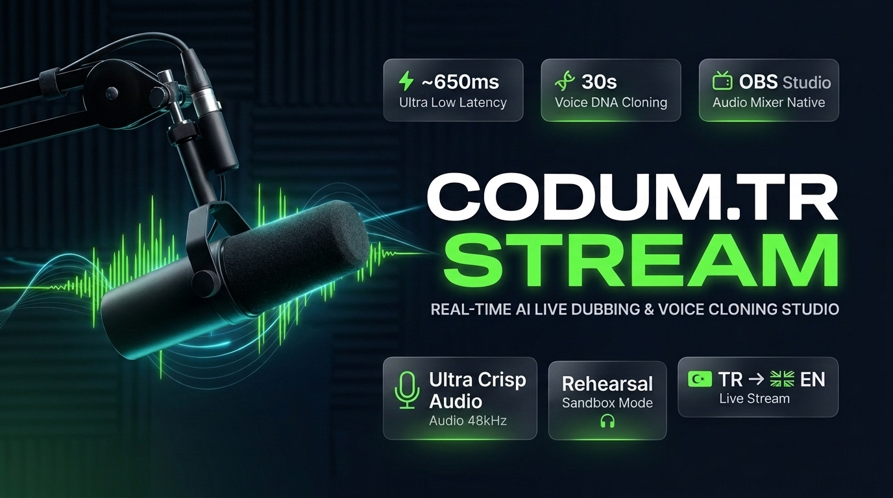

# ⚡ CODUM.TR STREAM PRO STUDIO
### 🎙️ Gerçek Zamanlı AI Canlı Dublaj & Voice DNA Ses Klonlama Masası (~650ms)
### 🌍 Real-Time AI Live Dubbing & Voice DNA Cloning Studio for Kick, Twitch & OBS Streamers

<div align="center">



<br><br>

[](https://github.com/codumtr/CODUM-STREAM/releases/tag/v1.0.0-PRO)
[-blue.svg?style=for-the-badge&logo=windows)](https://github.com/codumtr/CODUM-STREAM/releases/download/v1.0.0-PRO/CODUM_StreamDub_v1.0.0_Windows.zip)
[](https://obsproject.com)
[](https://kick.com)

<br>

### 🇹🇷 Türkçe Konuş ➔ 🇬🇧 Kendi Ses Tonunla İngilizce Canlı Dublaj Yay!
**Sıfır Kurulum Karmaşası • 5 Adımlı İnteraktif Kurulum Sihirbazı • Kalıcı Ayar Hafızası • Bağımsız Masaüstü Programı**

[📥 Windows Programını İndir (.zip)](https://github.com/codumtr/CODUM-STREAM/releases/download/v1.0.0-PRO/CODUM_StreamDub_v1.0.0_Windows.zip) • [📖 Türkçe Kurulum Kılavuzu](#-türkçe-özet--kurulum) • [📺 OBS Entegrasyonu](#-obs-studio-sesli-entegrasyon) • [⚡ English Guide](#-english-overview)

</div>

---

## ⚡ English Overview

**CODUM.TR STREAM** is an ultra-low-latency live dubbing platform designed specifically for Turkish live streamers broadcasting on Kick and Twitch to global English-speaking audiences.

Unlike conventional machine translation tools that produce robotic voices and literal translations, CODUM.TR STREAM preserves the streamer's **original voice identity**, **emotional energy**, and **humorous gaming slang** in real-time.

### 🌟 Key Innovations

1. **🧬 Voice DNA Neural Cloning:** In-browser 30-second acoustic profiling with automated signal quality scoring (clipping, RMS background noise, SNR) before cloning via ElevenLabs Turbo v2.5.
2. **🌍 Cultural Language Intelligence:** Prevents word-for-word translation blunders. Turkish idioms like *"kafayı yersin"* are naturally mapped to *"that's completely insane / mind-blown"*, and *"patladık"* becomes *"we're cooked bro"*.
3. **🎧 Rehearsal Sandbox Mode:** Streamers can pre-listen to their cloned English voice inside their headphones with zero audio leaking to OBS or viewers.
4. **📺 Native OBS Audio Routing:** Outputs synchronized subtitles and actual live dubbed audio straight into OBS Studio via Browser Source (`Control audio via OBS`).
5. **🛡️ Streamer Shield (Privacy Mode):** Instantly blurs Stream Keys, API credentials, and revenue telemetry with frosted glass effects during screen sharing.
6. **🧩 Chrome Extension with Web Audio Ducking:** Automatically lowers the streamer's original Turkish voice to 20% background whisper when the English dub speaks on Kick.com.
7. **📦 Zero-Install Standalone EXE:** Ships with a pre-compiled Windows executable (`CODUM_StreamDub.exe`). **No Python installation required.**

---

## 🏛️ Architecture & Latency Pipeline

```text
[ Streamer Mic ] (16kHz PCM Web Audio)
       │
       ▼
[ Streaming VAD ] (NumPy Energy Matrix & Sample Frame Counter)
       │
       ▼  (~120ms)
[ Groq Whisper Large v3 ] (Speech-to-Text with Gaming Slang Prompt Hints)
       │
       ▼  (~180ms)
[ Language Intelligence LLM ] (Groq LLaMA 3.3 70B / Google Gemini 2.0 Flash)
       │
       ▼  (~350ms)
[ Voice DNA TTS Engine ] (ElevenLabs Turbo v2.5 / Cartesia / Edge-TTS Failover)
       │
       ├─────────────────────────────────┐
       ▼ [🎧 Prova Modu]                 ▼ [🔴 Canlı Yayın]
[ Streamer Headphones ]         ┌─────────────────────────┐
(Zero OBS/Kick Leak)            │ OBS Studio Mixer        │ ──► [Global Audience]
                                │ Kick Chrome Ducking Ext │
                                └─────────────────────────┘
```

**End-to-End Latency:** `~650ms – 1.1s` (Optimized Pipeline Target).

> 💡 **Benchmark & Ölçüm Notu:** Bu gecikme aralığı; optimize edilmiş VAD penceresi, Groq Whisper Large v3 (~120ms chunking), Groq LLaMA 3.3 70B (~180ms TTFT) ve ElevenLabs Turbo v2.5 WebSocket streaming (~350ms ilk ses paketi) ile yüksek hızlı fiber bağlantı altında laboratuvar testlerinde ölçülen medyan süredir. Gerçek kullanımda gecikme, internet pinginize ve seçilen yapay zekâ sağlayıcısına bağlı olarak değişkenlik gösterebilir.

---

## 💰 Unit Economics & Exact API Costs

CODUM.TR STREAM uses a **BYOK (Bring Your Own Key)** architecture. Streamers use their own free or low-cost API keys with zero platform markup:

| Pipeline Step | Provider / Model | Consumption / 1h Stream | Cost / Hour |
|---|---|---|---|
| **VAD + STT** | Groq Whisper Large v3 | ~35 mins active speech | **~$0.10** |
| **Translation** | Groq LLaMA 3.3 / Gemini 2.0 | ~4,500 words | **~$0.03** |
| **Voice Cloning** | ElevenLabs Turbo v2.5 | ~25,000 characters | **~$0.50** |
| **Total AI Cost** | | | **~$0.63 / hour** |

*(Note: Edge-TTS and local rule fallbacks are 100% free).*

---

## 🇹🇷 Türkçe Özet & Özellikler

CODUM.TR STREAM, Türk yayıncıların yayınlarını dünyaya açabilmesi için geliştirilmiş profesyonel bir canlı dublaj stüdyosudur.

### Neden Klasik Çeviricilerden Farklı?
* **Robotik Ses Yok:** Kendi ses tonunuzu 30 saniyede klonlar, İngilizce konuşurken de sizin tınısınızla konuşur.
* **Motamot Çeviri Tuzağı Engellendi:** *"Gözünü seveyim"* sözünü *"let me love your eye"* diye değil, *"come on bro, please"* diye çevirir.
* **Kulaklık Provası (Sandbox):** Yayına vermeden önce kendi kulaklığınızda sesinizi test edebilirsiniz.
* **OBS Mikser Çıkışı:** OBS'e sadece altyazı değil, gerçek İngilizce dublaj sesi akar.

---

## 🚀 Hızlı Kurulum (Quickstart)

### Yöntem 1: Bağımsız Masaüstü Programı (Önerilen - Python Gerekmez!)
1. Sağ taraftaki **[Releases (v1.0.0-PRO)](https://github.com/codumtr/CODUM-STREAM/releases/tag/v1.0.0-PRO)** bölümünden `CODUM_StreamDub_v1.0.0_Windows.zip` dosyasını indirin.
2. Arşivi bir klasöre çıkartın (**"Tümünü Ayıkla" / "Extract All"** deyin).
3. Klasör içindeki **`CODUM_StreamDub.exe`** dosyasına çift tıklayın.
4. Discord / OBS tarzında bağımsız, karanlık temalı **Masaüstü Yönetim Penceresi** anında açılacaktır!
5. Klasördeki **`KULLANIM_KILAVUZU.txt`** dosyasında OBS, mikrofon ve ses klonlama ayarları adım adım anlatılmaktadır.

### Yöntem 2: Kaynak Koddan Çalıştırma (Geliştiriciler İçin)
```bash
# 1. Projeyi klonlayın
git clone https://github.com/codumtr/CODUM-STREAM.git
cd CODUM-STREAM

# 2. Bağımlılıkları yükleyin
pip install -r requirements.txt

# 3. Sunucuyu başlatın
python run_app.py
```

---

## 📺 OBS Studio Sesli Entegrasyon

1. OBS Studio'da **Kaynaklar (Sources)** kutusunda `+` butonuna basıp **Tarayıcı (Browser Source)** seçin.
2. URL kısmına stüdyodaki bağlantıyı yapıştırın:
   ```text
   http://127.0.0.1:8765/overlay?channel=streamer
   ```
3. Genişlik: `1920`, Yükseklik: `1080` yapın.
4. **ÇOK ÖNEMLİ:** **"Sesi OBS üzerinden kontrol et" (Control audio via OBS)** kutucuğunu MUTLAKA işaretleyin.
5. OBS Ses Karıştırıcısı'nda yeni bir ses çubuğu belirecektir; dublaj sesi doğrudan yayına aktarılır!

---

## 🧩 Kick.com İzleyici Eklentisi (Audio Ducking)

1. Google Chrome'da `chrome://extensions/` adresine gidin.
2. Sağ üst köşeden **Geliştirici Modu (Developer Mode)** anahtarını açın.
3. **"Paketlenmemiş öge yükle"** butonuna basarak projedeki `extension/` klasörünü seçin.
4. Kick.com'da yayını açtığınızda video oynatıcıda yeşil **`🎙️ EN DUB`** butonunu göreceksiniz. İngilizce dublaj konuşurken orijinal Türkçe ses arka planda fısıltı seviyesine (%20) indirilir.

---

## 📁 Proje Dosya Yapısı

```text
CODUM-STREAM/
├── dist/CODUM_StreamDub/     # Python gerektirmeyen hazır Windows EXE paketi
├── core/
│   ├── vad.py                # NumPy tabanlı gerçek zamanlı konuşma aktivite tespiti
│   ├── stt.py                # Groq Whisper Large v3 konuşma tanıma
│   ├── language_intelligence.py # 30+ Türkçe argo ve kültürel deyim motoru
│   ├── translator.py         # LLaMA 3.3 / Gemini 2.0 hibrit çevirici
│   ├── tts_engine.py         # ElevenLabs / Cartesia / Edge-TTS ses klonlayıcı
│   ├── audio_validator.py    # Akustik kalite analizörü (0-100 skor)
│   ├── health_monitor.py     # Gecikme ölçer, devre kesici ve akıllı kuyruk düşürücü
│   └── license_guard.py      # Kriptografik mühür ve orijinallik doğrulayıcı
├── server/
│   ├── app.py                # FastAPI & WebSocket dağıtım merkezi
│   ├── room_manager.py       # Çok kanallı oda ve maliyet telemetrisi
│   └── kick_bot.py           # Kick webhook & sohbet botu
├── streamer_dashboard/       # Yayıncı kontrol stüdyosu (Web Audio API & VU Meter)
├── overlay/                  # OBS Browser Source (Sesli + Canlı Altyazı)
├── extension/                # Kick.com Chrome eklentisi (Audio Ducking)
├── profiles/                 # Yayıncı Voice DNA profilleri
├── run_app.py                # Standalone EXE giriş noktası
├── build_exe.bat             # 1-tıkla Windows EXE derleme betiği
├── baslat.bat                # 1-tıkla sunucu başlatma betiği
├── LICENSE.md                # Tescilli Ücretsiz Yayıncı Lisansı
└── README.md                 # Ana dokümantasyon
```

---

## 📄 Lisans & Telif Hakları

Bu yazılım **CODUM.TR STREAM** tarafından geliştirilmiş tescilli bir canlı yayın teknolojisidir. Bireysel ve ticari yayıncılar için **ücretsizdir**.

* Yazılımın kaynak kodları üzerinde kişisel düzenleme yapılabilir.
* Ancak yazılımın adının değiştirilmesi (re-branding), telif hakkı ve orijinallik mührünün silinmesi veya başka bir isim altında ücretli satılması **kesinlikle yasaktır**.
* Detaylı kullanım koşulları için [LICENSE.md](LICENSE.md) dosyasını inceleyiniz.

---

<div align="center">
Geliştirici & Telif Sahibi: <b>CODUM.TR STREAM</b> &bull; Tüm Hakları Saklıdır &copy; 2026
</div>
